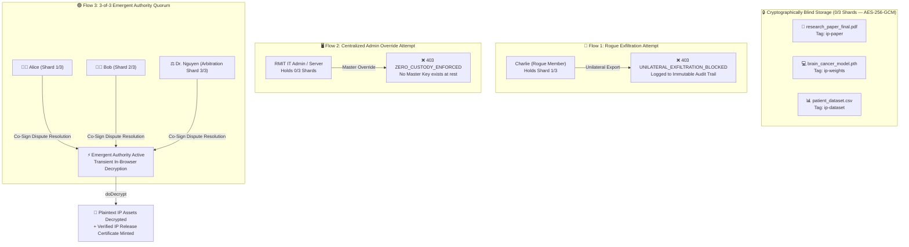

[](https://tide.org/tidecloak?utm_source=github&utm_medium=readme&utm_campaign=unlocked)

# ScholarLock

> **A zero-trust academic IP vault where no rogue co-author, university administrator, or cloud operator can unilaterally steal, decrypt, or commercialize shared research breakthroughs.**

## Vision & originality
- **Cryptographic Co-Ownership:** High-value research assets (`research_paper_final.pdf`, `brain_cancer_model.pth`, `confidential_patient_dataset.csv`) are locked without any static master key.
- **Emergent Authority:** Decryption and export authority never exists at rest—it emerges transiently in-browser only when co-author identities, tag policies, and quorum signatures align.

## Trust constraint insight
- **The Bottleneck:** Collaborative research is held back by insider exfiltration (a rogue teammate stealing/selling AI weights) and centralized custody (IT admins holding master keys to unpublished drafts).
- **The Breakthrough:** By removing unilateral control, teams can co-train proprietary models on sensitive clinical data without trusting a central operator or fearing a rogue partner.

## Value & impact
- **Sovereignty for Co-Authors:** Student innovators and university labs retain verifiable ownership over joint IP.
- **Deadlock-Proof Arbitration:** If a rogue member ("Charlie") attempts unilateral IP theft, ScholarLock blocks export (`1/3 shards`) and triggers an ethics-arbitrated dispute quorum (`3/3 shards`) so honest researchers are never held hostage.

## Why TideCloak matters
- **Beyond Standard RBAC:** Conventional RBAC relies on servers that hold plaintext master keys.
- **TideCloak Enforced:** Built on `@tidecloak/react` (`useTideCloak`, `hasRealmRole`, tag-bound `doEncrypt`/`doDecrypt`). Research assets remain **100% cryptographically blind (`AES-256-GCM`)**—unilateral insider or admin overrides are mathematically impossible.

## Prototype & storytelling
Judges can test two contrasting live flows:
1. 🔴 **Rogue & Admin Attacks Blocked:** Click Charlie’s **"Attempt Unilateral IP Export"** (`403 UNILATERAL_EXFILTRATION_BLOCKED` — `1/3 shards`) and test **"Admin Master Override"** (`403 ZERO_CUSTODY_ENFORCED` — `0/3 shards`).
2. 🟢 **Emergent Authority Release:** Alice, Bob, and Ethics Chair Dr. Nguyen co-sign a **3-of-3 Quorum** to revoke Charlie’s shard, decrypt the full IP bundle in-browser, and mint a verified release certificate.

---

## 🏛️ How Emergent Authority Works (Architecture)



---

## 🚀 Setup & Demo Guide

### Quick Start (Works Instantly in 60s)

```bash
# 1. Install dependencies
npm install

# 2. Launch Vite development server
npm run dev
```

Open **`http://localhost:5137`** in your browser.

> [!NOTE]
> **Zero-Friction Judge Evaluation (Default):** ScholarLock includes an interactive simulation mode that executes the full cryptographic lifecycle, tag-bound E2EE envelopes (`TIDE_E2EE_V1`), quorum state machine, and immutable audit logs directly out of the box without requiring Docker.

---

### 🔌 Live TideCloak Mode (Optional)

To connect ScholarLock to a live TideCloak OIDC + E2EE instance:

```bash
docker run -d -p 8080:8080 \
  -e KC_BOOTSTRAP_ADMIN_USERNAME=admin \
  -e KC_BOOTSTRAP_ADMIN_PASSWORD=password \
  tideorg/tidecloak-dev:latest
```
*Export your client configuration from `http://localhost:8080` and save it to `public/tidecloak.json`.*

---

## 👥 Demo Actors & Authority Shards

| Actor | Role | Authority Shard | Custody / Capability |
| :--- | :--- | :---: | :--- |
| 👩‍🔬 **Alice (AI Lead)** | `co-author` | **Shard 1/3** | Daily working preview; requires 3/3 quorum for full bundle export |
| 👨‍💻 **Bob (Data Engineer)** | `co-author` | **Shard 2/3** | Daily working preview; requires 3/3 quorum for full bundle export |
| 🚨 **Charlie (Rogue Member)** | `co-author` | **Shard 3/3** *(Revocable)* | Attempts unilateral sale; blocked by missing quorum (`1/3`) |
| ⚖️ **Dr. Nguyen (Ethics Chair)** | `ethics-arbitrator` | **Arbitration Shard** | Replaces Charlie's revoked shard upon immutable breach evidence |
| 🖥️ **RMIT IT Admin / Server** | `sysadmin` | **0/3 Shards** | **Blind Storage** — sees only ciphertext; cannot decrypt or export |

---

## 🔐 Vault Protected IP Assets

| Asset File | Content & Sensitivity | TideCloak Tag | Ciphertext Envelope |
| :--- | :--- | :---: | :--- |
| 📄 `research_paper_final.pdf` | Novel Vision-Transformer architecture draft | `ip-paper` | `TIDE_E2EE_V1[ip-paper]::...` |
| 💻 `brain_cancer_model.pth` | 400-GPU-hour trained weights (96.4% Acc) | `ip-weights` | `TIDE_E2EE_V1[ip-weights]::...` |
| 📊 `confidential_patient_dataset.csv` | 1,200 anonymized clinical MRI records | `ip-dataset` | `TIDE_E2EE_V1[ip-dataset]::...` |

---

## 🎮 3 Key Demo Interactions for Judges

Follow these 3 flows in the **Command Center** to test all security properties:

### 1️⃣ Flow 1: Rogue Insider Exfiltration Blocked
- **Where:** Switch to the **`Rogue Insider (Charlie)`** tab.
- **Action:** Click **"🚨 Charlie: Attempt Unilateral IP Export (Sell to Company)"**.
- **Result:** 
  - 🛑 Blocked with **`403 UNILATERAL_EXFILTRATION_BLOCKED`** (`Charlie holds only 1 of 3 required shards`).
  - 📝 An immutable violation event is automatically signed and logged into the **Audit Trail**.

### 2️⃣ Flow 2: Blind Server & Admin Override Blocked
- **Where:** Switch to the **`Blind Server / IT Admin`** tab.
- **Action:** Inspect the raw database records (100% blind ciphertext), then click **"⛔ Attempt Admin Master Override"**.
- **Result:**
  - 🛑 Blocked with **`403 ZERO_CUSTODY_ENFORCED`** (`Operator holds 0 of 3 shards; no Master Key exists at rest`).
  - 🛡️ Proves storage is cryptographically blind rather than protected by conventional server-side RBAC.

### 3️⃣ Flow 3: 3-of-3 Emergent Authority Quorum
- **Where:** Switch to the **`Quorum & Dispute Panel`** tab.
- **Action:** Based on Charlie's breach log, assemble the **3-of-3 Key Shards**:
  1. Click **"Alice: Co-Sign Approval"** *(Shard 1/3)*
  2. Click **"Bob: Co-Sign Approval"** *(Shard 2/3)*
  3. Click **"Dr. Nguyen: Revoke Charlie & Co-Sign"** *(Arbitration Shard 3/3)*
- **Result:**
  - ⚡ **Emergent Authority Activates:** Client-side decryption (`doDecrypt`) unlocks all 3 plaintexts in-memory.
  - 📜 A cryptographically verifiable **Verified IP Release Certificate** is minted with consensus signatures.

---

## 📹 Video Demonstration
A 2-minute walkthrough showing all three flows is included in the repository at **`scholar_lock_demo.mp4`**.
