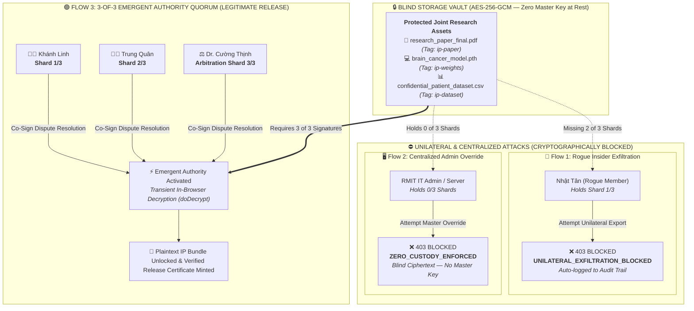

[](https://tide.org/tidecloak?utm_source=github&utm_medium=readme&utm_campaign=unlocked)

# ScholarLock

> **A zero-trust academic IP vault where no rogue co-author, university administrator, or cloud operator can unilaterally steal, decrypt, or commercialize shared research breakthroughs.**

## Vision & originality
- **Cryptographic Co-Ownership:** Shared research assets (model weights, clinical datasets, papers) are locked with zero master keys at rest.
- **Emergent Authority:** Decryption authority emerges transiently in-browser only when co-author identities, tag policies, and quorum signatures align.

## Trust constraint insight
- **The Bottleneck:** Collaborative research is stalled by insider theft (a rogue member selling AI weights) and centralized custody (IT admins holding keys to unpublished drafts).
- **The Breakthrough:** Eliminating unilateral control enables joint training on sensitive data without trusting a central operator or fearing a rogue partner.

## Value & impact
- **Sovereignty for Co-Authors:** Student researchers and university labs retain cryptographically verifiable ownership over joint IP.
- **Deadlock-Proof Arbitration:** If a rogue member attempts unilateral theft, ScholarLock blocks export (1/3 shards) and triggers an ethics dispute quorum (3/3 shards) so honest researchers are never held hostage.

## Why TideCloak matters
- **Beyond Standard RBAC:** Conventional RBAC relies on servers holding plaintext keys.
- **TideCloak Enforced:** Built on `@tidecloak/react` (`useTideCloak`, `hasRealmRole`, tag-bound `doEncrypt`/`doDecrypt`). Vault assets remain 100% cryptographically blind (`AES-256-GCM`)—unilateral insider or admin overrides are mathematically impossible.

## Prototype & storytelling
Judges can test two contrasting live flows:
1. 🔴 **Attacks Blocked:** Click Nhật Tân’s **"Attempt Unilateral IP Export"** (`403 UNILATERAL_EXFILTRATION_BLOCKED` — 1/3 shards) and test **"Admin Master Override"** (`403 ZERO_CUSTODY_ENFORCED` — 0/3 shards).
2. 🟢 **Emergent Authority Release:** Khánh Linh, Trung Quân, and Dr. Cường Thịnh co-sign a **3-of-3 Quorum** to revoke the rogue shard, decrypt the IP bundle in-browser, and mint a verified release certificate.

---

## 🏛️ How Emergent Authority Works (Architecture)



> [!TIP]
> **Key Architecture Takeaway for Judges:**
> - **At Rest (Zero Admin Custody):** The server stores only blind ciphertext (`AES-256-GCM`). Neither IT Admins (`0/3` shards) nor rogue insiders (`1/3` shards) possess a master key.
> - **At Runtime (Emergent Authority):** Authority only **emerges transiently** in the client browser when a valid **3-of-3 consensus quorum** is cryptographically assembled.

---

## 🚀 Setup & Demo Guide

### Quick Start (Works Instantly in 60s)

```bash
# 1. Install dependencies
npm install

# 2. Launch Vite development server
npm run dev
```

Open **`http://localhost:5137`** in your browser.

> [!NOTE]
> **Official Plan C & Zero-Friction Judge Evaluation (Default):**
> Following the official Hackathon announcement (*"Tide's network is under heavy load... Build your prototype as though TideCloak were protecting it, and simulate those protections for now. Simulated and live integrations are judged exactly the same"*), ScholarLock fully implements TideCloak's architecture:
> - **Sign-In & Identity:** Passwordless WebAuthn/Enclave identity simulation with `Ed25519` hardware assertions.
> - **Roles & Entitlements:** Mapped to cryptographic authority shards (`co-author` 1/3, `ethics-arbitrator` 3/3, `sysadmin` 0/3).
> - **Tag-Bound Access Checks:** Client-side E2EE envelopes (`TIDE_E2EE_V1`) bound to tags `ip-paper`, `ip-weights`, `ip-dataset`.
> - **Emergent Authority Quorum:** 3-of-3 threshold consensus with zero master keys at rest.
> - Click the **"🏛️ Plan C: Where TideCloak Fits"** button in the app header to view the live interactive architectural blueprint.

---

### 🔌 Live TideCloak Mode (Optional)

To connect ScholarLock to a live TideCloak OIDC + E2EE instance:

```bash
docker run -d -p 8080:8080 \
  -e KC_BOOTSTRAP_ADMIN_USERNAME=admin \
  -e KC_BOOTSTRAP_ADMIN_PASSWORD=password \
  tideorg/tidecloak-dev:latest
```
*Export your client configuration from `http://localhost:8080` and save it to `public/tidecloak.json`.*

---

## 👥 Demo Actors & Authority Shards

| Actor | Role | Authority Shard | Custody / Capability |
| :--- | :--- | :---: | :--- |
| 👩‍🔬 **Khánh Linh (AI Lead)** | `co-author` | **Shard 1/3** | Daily working preview; requires 3/3 quorum for full bundle export |
| 👨‍💻 **Trung Quân (Data Engineer)** | `co-author` | **Shard 2/3** | Daily working preview; requires 3/3 quorum for full bundle export |
| 🚨 **Nhật Tân (Rogue Member)** | `co-author` | **Shard 3/3** *(Revocable)* | Attempts unilateral sale; blocked by missing quorum (`1/3`) |
| ⚖️ **Dr. Cường Thịnh (Ethics Chair)** | `ethics-arbitrator` | **Arbitration Shard** *(Dormant)* | Cryptographically dormant until an immutable `403` breach log exists (prevents collusion); replaces Nhật Tân's revoked shard |
| 🖥️ **RMIT IT Admin / Server** | `sysadmin` | **0/3 Shards** | **Blind Storage** — sees only ciphertext; cannot decrypt or export |

---

## 🔐 Vault Protected IP Assets

| Asset File | Content & Sensitivity | TideCloak Tag | Ciphertext Envelope |
| :--- | :--- | :---: | :--- |
| 📄 `research_paper_final.pdf` | Novel Vision-Transformer architecture draft | `ip-paper` | `TIDE_E2EE_V1[ip-paper]::...` |
| 💻 `brain_cancer_model.pth` | 400-GPU-hour trained weights (96.4% Acc) | `ip-weights` | `TIDE_E2EE_V1[ip-weights]::...` |
| 📊 `confidential_patient_dataset.csv` | 1,200 anonymized clinical MRI records | `ip-dataset` | `TIDE_E2EE_V1[ip-dataset]::...` |

---

## 🎮 3 Key Demo Interactions for Judges

Follow these 3 flows in the **Command Center** to test all security properties:

### 1️⃣ Flow 1: Rogue Insider Exfiltration Blocked
- **Where:** Switch to the **`Rogue Insider (Nhật Tân)`** tab.
- **Action:** Click **"🚨 Nhật Tân: Attempt Unilateral IP Export (Sell to Company)"**.
- **Result:** 
  - 🛑 Blocked with **`403 UNILATERAL_EXFILTRATION_BLOCKED`** (`Nhật Tân holds only 1 of 3 required shards`).
  - 📝 An immutable violation event is automatically signed and logged into the **Audit Trail**.

### 2️⃣ Flow 2: Blind Server & Admin Override Blocked
- **Where:** Switch to the **`Blind Server / IT Admin`** tab.
- **Action:** Inspect the raw database records (100% blind ciphertext), then click **"⛔ Attempt Admin Master Override"**.
- **Result:**
  - 🛑 Blocked with **`403 ZERO_CUSTODY_ENFORCED`** (`Operator holds 0 of 3 shards; no Master Key exists at rest`).
  - 🛡️ Proves storage is cryptographically blind rather than protected by conventional server-side RBAC.

### 3️⃣ Flow 3: 3-of-3 Emergent Authority Quorum
- **Where:** Switch to the **`Quorum & Dispute Panel`** tab.
- **Anti-Collusion Guardrail:** Notice that Dr. Cường Thịnh's **Arbitration Shard 3/3** starts in a **`🔒 DORMANT (NO BREACH)`** state while Nhật Tân is in good standing—preventing two students and an advisor from colluding to exclude an innocent co-author.
- **Action:** Once Nhật Tân's `403` breach is logged in the **Audit Trail**, assemble the **3-of-3 Threshold Key Shards**:
  1. Click **"👩‍🔬 Khánh Linh: Sign Shard 1/3 (Co-Author Approval)"**
  2. Click **"👨‍💻 Trung Quân: Sign Shard 2/3 (Co-Author Approval)"**
  3. Click **"⚖️ Dr. Cường Thịnh: Revoke Nhật Tân & Sign Arbitration Shard 3/3"**
- **Result:**
  - ⚡ **Emergent Authority Activates:** Client-side decryption (`doDecrypt`) reconstructs the Master Bundle key transiently in-browser and unlocks all 3 plaintexts.
  - 📜 A cryptographically verifiable **Verified IP Release Certificate** is minted with consensus signatures and the permanent revocation record.

---

## 📹 Video Demonstration
A 2-minute walkthrough showing all three flows is included in the repository at **`scholar_lock_demo.mp4`**.
